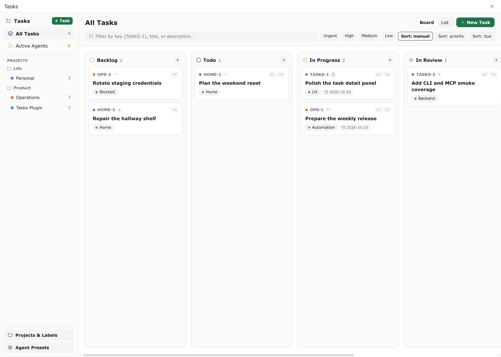
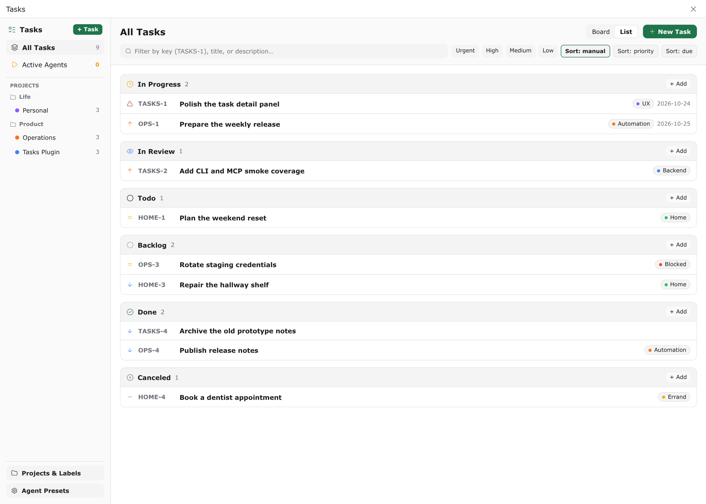
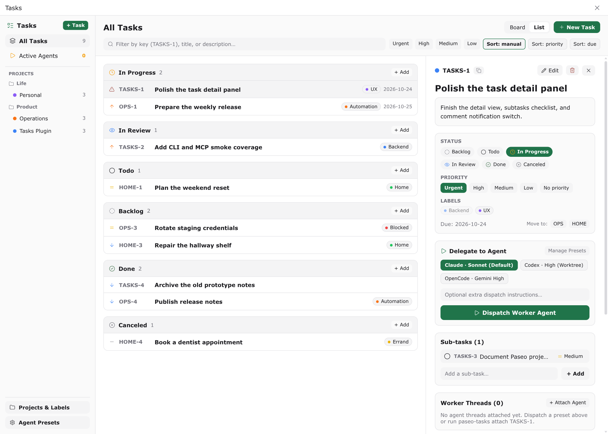

# Tasks for Paseo

**A local task tracker in Paseo: kanban board and grouped list, subtasks, comments, attachments, and one-click delegation to a coding agent that reports back to the same task.**







Ported from the `tasks` plugin in the [BB](https://github.com/get-bb/bb) monorepo (MIT) to Paseo's native screens, panels, composer pills, timeline renderers, and daemon RPC architecture.

## Install

```bash
paseo plugin add git:anh-chu/paseo-plugin-tasks
```

Or from npm:

```bash
paseo plugin add npm:paseo-plugin-tasks
```

Requires Paseo 0.11.2 or later, and Node 24 or later on the daemon host (the store uses the built-in `node:sqlite` module).

## Quick start

1. Open **Tasks** in the sidebar, or run `/tasks` in a workspace composer.
2. Pick **Seed Sample Projects & Tasks** from the command center, or create a project under **Projects & Labels** and add a task.
3. Open a task and dispatch it with a preset under **Delegate to Agent**.
4. The agent works in place or in a new worktree, comments on the task as it goes, and sets the status when it is done.

## Delegation

A preset bundles a provider and model, a thinking level, an optional fast service tier, a permission mode, and the environment:

| Field | Values |
| --- | --- |
| Environment | `project-default` (run in the linked Paseo project) or `new-worktree` (branch a fresh git worktree from the project) |
| Permission mode | `accept-edits`, `auto`, or `full` |
| Service tier | normal or fast, when the provider supports it |

Dispatching builds a seed prompt containing the task, its description, sub-tasks, attachments, recent comments, the preset's own instructions, and anything you type in the dispatch box. The new agent session is attached to the task automatically.

Three presets ship with the plugin on first use: Codex with high thinking in a new worktree, Claude Sonnet in the default environment, and OpenCode with Gemini at high thinking. Edit them under **Agent Presets**.

## Worker report-back

Agents receive two ways to talk back to the tracker.

### `paseo-tasks` CLI

The plugin puts a `paseo-tasks` command on each agent's `PATH`, with `bb-tasks` and `bb` as aliases. Add `--json` to any command for machine-readable output.

```
status                                Show the installed Tasks plugin name and version
project create|list|show|update       Manage projects, prefixes, and Paseo project links
folder create|list|update|delete      Group projects into folders
create                                Create a task (--project, --title, --description, --priority, --due, --label, --parent, --attach)
list                                  List and filter tasks (--project, --status, --priority, --label, --active, --search, --sort, --limit, --cursor)
show <key-or-id>                      Show the task, sub-tasks, comments, attachments, and attached agents
update <key-or-id>                    Change status, priority, title, description, due date, parent, or labels
move <key-or-id>                      Move a task and its sub-tasks to another project
comment <key-or-id>                   Add a Markdown comment (--body or --body-file, optional --notify)
attachment add|get|list|remove        Manage task and comment attachments
preset list|show|create|update|delete Manage reusable agent execution presets
delegate <key>                        Start and attach a new agent from a preset
attach <key-or-id>                    Attach an agent session (--thread or $PASEO_AGENT_ID)
detach <key-or-id>                    Detach an agent session
threads <key>                         List agent sessions attached to a task
label create|list|delete              Manage project-scoped labels
seed-demo --yes                       Create sample folders, projects, labels, tasks, and comments
```

### `tasks` MCP server

The same operations are exposed as MCP tools: `tasks_projects`, `tasks_list`, `tasks_show`, `tasks_create`, `tasks_update`, `tasks_comment`, `tasks_delegate`, `tasks_attach`, and `tasks_detach`.

### Task cards in replies

An agent that writes `::task{key="ABC-12"}` on its own line gets a live task card in place of that line. Clicking the card opens the task.

### Comment steering

A comment sent with **Notify agent** is delivered to the agent that last replied on the task, or to its most recently attached session, as updated context for the work in progress.

## Surfaces

| Surface | Where |
| --- | --- |
| Tasks screen | Sidebar item, `/tasks [TASK-KEY]`, command center |
| Workspace board panel | Workspace and explorer panels, command center |
| Agent task inspector | Agent panel, `/task-panel`, composer pill |
| Composer pill | Beside the composer for each agent; shows the linked task key |
| Attachment picker | `@` and `+` pickers in the composer |
| Settings | **Settings → Plugins → Tasks** |

## Settings

| Setting | Default | Effect |
| --- | --- | --- |
| Inject paseo-tasks CLI and MCP server | on | Adds the helper script directory to an agent's `PATH` and registers the MCP server on new agents |
| Inject Tasks reporting instructions | on | Appends the report-back contract to an agent's system prompt |
| Default view | Board | Board or grouped list when the screen opens |
| Show completed tasks on the board | on | Includes Done and Canceled columns |

## How it is built

- **Store**: one SQLite database at `$PASEO_HOME/plugin-data/tasks/tasks.db` (WAL), with migrations applied on load. Task keys are `PREFIX-NUMBER`; moving a task to another project keeps the old key as a working alias.
- **Bridge**: the plugin server serves a loopback HTTP endpoint with a random bearer token written to `$PASEO_HOME/plugin-data/tasks/bridge.json` (owner-only). It writes `paseo-tasks`, `bb-tasks`, `bb`, and `tasks-mcp.mjs` into `$PASEO_HOME/plugin-data/tasks/bin`. The CLI and MCP server refuse to run without the bridge, so the daemon is the single writer.
- **Agent wiring**: a `before` hook on agent creation injects the MCP server and the instructions; a `before` hook on session open prepends the bin directory to `PATH` and sets `BB_THREAD_ID` and `PASEO_TASK_KEY`.
- **Lifecycle**: `agent.created`, `agent.turn_started`, `agent.turn_ended`, `agent.closed`, and `agent.archived` update the tracked state of each attached session. Closing or failing writes a system comment on the task.

## Development

```bash
npm install
npm run typecheck
npm test
paseo plugin install /path/to/paseo-plugin-tasks
paseo plugin reload tasks
```

The test suite covers the store and board moves with key aliases, cursor paging, delegation with lifecycle transitions and comment steering, the CLI and HTTP/MCP bridge, and the timeline directive transform.

## License

Apache-2.0. Ported from the `tasks` plugin in [get-bb/bb](https://github.com/get-bb/bb) (MIT).
